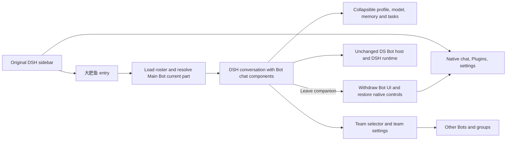

# Embedded companion in the original DSH interface

This is the MyAgent fork's first UI change, requested by its owner. It differs from upstream's team-wide shell design. The reference is a persistent companion entry beside the normal conversations, with its chat in the center and its details on the right. Product assets and code are not copied from the visual reference.

## Boundaries

- DSH owns branding, sidebar, workspaces, New chat, Plugins, scheduled tasks, account, global settings and shortcuts.
- One registered `sidebar.panellist` entry opens a keyed `main` landing panel. Once the roster is ready, it opens the Main Bot's current conversation through `uiWorkspace.openSession`.
- A visible conversation owned by the Bot roster mounts upstream chat cells, overlays and details. The header selects another Bot or group and opens team settings. The details panel can collapse.
- Another main panel or an ordinary conversation withdraws these replacements and clears companion overlays and reserved panel space. No ordinary session is automatically adopted into a Bot or Agent.
- A Bot's context rollover follows only that Bot's next part. Earlier parts, memory, tools, groups and execution continue to use upstream host services.
- Global DSH theme tokens and search-provider settings are not overwritten. Bot-specific theme variables are mounted only with companion UI.
- The separate upstream app keeps the legacy shell CSS export. This release targets the plugin, not a new desktop installer.



## Distribution

The package remains `ds-bot` and uses version `0.2.0-myagent.1`, so a local package replaces the upstream plugin without creating another team. New teams default to 大肥鱼; the host does not rename existing teams. Update checks default to off to avoid presenting an upstream package as a fork update. This is not an npm publication.

The earlier `dsh-myagent` prototype is a separate plugin with separate data. This change does not migrate its memory or remove its sidebar entry. If both plugins are enabled, their entry labels can coincide. Do not imply that their stored memories have merged.

## Verification

Unit coverage in `test/companion-navigation.test.js` covers owned conversations, groups, ordinary sessions, a Bot retained behind another main panel, and current-part resolution. The existing header tests remain applicable.

`dev/companion-ui.mjs` exercises the plugin against an isolated mock-model DSH Web profile. It checks native navigation, companion replies, detail spacing and reopening, other Bots and groups, Plugins navigation, an ordinary chat's reply and native model/permission controls, and access to global settings. It writes screenshots only into the ignored bench directory. No real account, model credentials or user DSH data are needed.

Example on Windows with Edge, from the repository root after starting the isolated bench:

```powershell
$env:BROWSER_CHANNEL = 'msedge'
node ds-bot/dev/companion-ui.mjs .dsh-test-ui .dsh-test-ui/web.log 3098
```

The first argument is a directory with `playwright-core` resolvable from its `package.json`; install test tooling outside the shipped plugin. The server log argument must be inside a `.dsh-test-*` directory. The script reads the local authentication URL without printing it. Use this check only with mock models and synthetic data.

Run `npm test`, `node scripts/build-client.mjs --check` and `npm run lint` in `ds-bot/`. Actual DSH Desktop testing is a separate acceptance step; a Web browser test does not verify Electron-only features such as embedded browser guests.

### Result on 2026-10-22

- DSH 0.2.1-rc.2, Node 24.14.1, Windows, headless Edge, mock model and isolated `DSH_HOME`.
- Unit suite: 834 passed, 0 failed, 1 skipped (Windows drops trailing spaces from directory names).
- Generated client check passed; lint exited successfully with the same 11 upstream warnings.
- Browser flow passed, including the header at 1024px, details reopen, team/group switching, an ordinary chat reply and the original global-settings dialog. No unhandled browser errors.
- No host implementation files changed. Upstream identity/memory scopes remain in place; this release does not add a stricter backend boundary around the team tools that upstream exposes to ordinary sessions.
- Test data and screenshots stay in ignored `.dsh-test-*` folders. The user's DSH profile was not modified.
