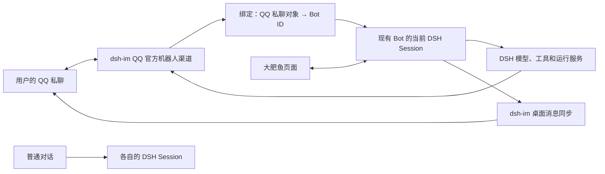

# 通过 dsh-im 接入现有伙伴

- 日期：2026-10-22
- 范围：本分支的纯插件形态，先验证 QQ 官方机器人私聊。

## 集成方式

直接安装发布版 `@xmanrui/dsh-im@5.4.0`，使用它自带的「绑定bot」。当前 `ds-bot@0.2.0-myagent.4` 保留上游包名与 `/api/bot` 接口，dsh-im 可以发现现有团队并解析 Bot 的当前 Session。此次没有增加生产代码、复制通信模块或修改 DSH。



首次接入时，先发一条 QQ 私聊，让 dsh-im 建立私聊记录，再到该账号的「更多设置 → 绑定bot」选择现有主 Bot 和私聊对象。扫码接入账号与绑定 DS Bot 是两个步骤。绑定前的私聊可能创建独立的普通 Session；保存绑定不会自动迁移或删除这段历史。

绑定后的 QQ 消息使用现有 Bot 的会话、模型和权限。桌面中发给该 Bot 的文字与助手回复也会同步到绑定的 QQ 私聊。普通会话没有这条绑定，不应转发。原有 DSH 侧栏、设置及大肥鱼界面继续保留。

## 已验证的范围

组合：DSH `0.2.1-rc.2`、本分支 `0.2.0-myagent.4`、npm 发布版 dsh-im `5.4.0`、Node `24.14.1`。

发布包从 npm 官方仓库取得并校验完整性：

```text
@xmanrui/dsh-im@5.4.0
sha512-hocDQXOAlQb/7rbuBsslIuTsNS+u09WXxzvZMY7kWdmeLdi4At1pywCUZkk/63x5AazpEsMvoi/fngHU3WPfJg==
```

隔离环境使用真实 DSH、两个实际插件和模拟模型；QQ SDK 的网络传输替换为捕获器，向真实 QQ bridge 注入已经规范化的私聊事件。测试代码调用发布包的内部模块只是固定版本的兼容性测试，不是生产插件依赖。

已通过：

- dsh-im 发现并绑定当前 fork 的主 Bot。
- 合成 QQ 入站消息进入 Bot 历史，经过模型后生成渠道回复。
- 重复的 QQ 消息 ID 不会再次生成回复。
- 另一个普通 Session 正常回答，不转发到已绑定的私聊。
- 桌面 Bot 输入及助手回答同步到该私聊。
- dsh-im 的 QQ 设置页与原有 DSH 导航共存。
- `dev/companion-ui.mjs` 在同时启用 dsh-im 的环境中通过，覆盖普通聊天、Bot/群切换、详情、归档恢复、权限修改及全局设置。

这些检查不证明腾讯网关、真实凭据、QQ 客户端收件或多媒体收发可用。真实账号的验证进度单独记录；对话换段、跨渠道并发、图片/语音/视频/文件仍需后续专项验证。

## 桌面接入与人工验收

1. 在 DSH 桌面「插件」页安装并启用 `@xmanrui/dsh-im@5.4.0`，重启。桌面 profile 由 Electron 管理，CLI 会拒绝修改它，应使用桌面安装界面。
2. 打开「IM机器人 → QQ」，由用户本人扫码创建并完成账号确认；凭据留在本机。
3. 给 QQ 机器人发一条私聊。展开账号设置，进入「更多设置 → 绑定bot」，刷新并选择已有主 Bot 与刚建立的私聊，保存。
4. 从 QQ 发送一个唯一的短标记，核对大肥鱼页面出现同一输入和回复，再核对 QQ 收到回复。
5. 从桌面给同一 Bot 发送另一条短标记，核对 QQ 收到桌面输入及回复。
6. 普通对话不应出现这些消息，也不应被转发。自动化回归只在下述隔离测试环境中运行。

2026-10-22 桌面验收：已安装 5.4.0，QQ 官方机器人在线，设置页确认保存私聊到现有主 Bot 的绑定。绑定后的 QQ 测试消息出现在大肥鱼页面，主 Bot 回复「收到」，用户确认 QQ 收到回复。真实 QQ 入站及响应回传通过；桌面主动输入的 QQ 同步继续单独核对。绑定前的独立 QQ Session 保留，未改动其他普通对话。

## 复现隔离测试

脚本位于 `ds-bot/dev/im-compat/`。Windows、Node、Edge、项目测试 harness 已安装；命令从仓库根目录运行。端口 3099、8799 必须空闲。不要把这些脚本安装进桌面 profile 或改成使用真实账号数据。

```powershell
New-Item -ItemType Directory -Force .dsh-test-im | Out-Null
Copy-Item -Path ds-bot/dev/im-compat/* -Destination .dsh-test-im -Recurse -Force
npm install --prefix .dsh-test-ui --no-audit --no-fund playwright-core@1.55.1
npm pack @xmanrui/dsh-im@5.4.0 --registry=https://registry.npmjs.org --pack-destination .dsh-test-im
$env:DSH_HOME = Join-Path (Get-Location) '.dsh-test-im/home'
node ds-bot/dev/harness/node_modules/@deepseek-ai/dsh/lib/bin.js plugin --profile web add -w .dsh-test-im/xmanrui-dsh-im-5.4.0.tgz
.\.dsh-test-im\start.ps1
```

等待测试服务启动后，初始化合成团队并检查：

```powershell
$env:BROWSER_CHANNEL = 'msedge'
try {
  node ds-bot/dev/companion-ui.mjs .dsh-test-ui .dsh-test-im/web.log 3099
  if ($LASTEXITCODE -ne 0) { throw 'Companion UI check failed' }
  node .dsh-test-im/check.mjs
  if ($LASTEXITCODE -ne 0) { throw 'IM compatibility check failed' }
} finally {
  .\.dsh-test-im\stop.ps1
}
```

启动脚本固定隔离目录及模拟模型；清理脚本校验 PID、可执行文件和进程启动时间，只停止本次记录的进程。登录地址、日志、状态文件和截图都留在被 Git 忽略的 `.dsh-test-im` 下，不发布。测试 fixture 不在插件的 npm `files` 清单内。

## 参考

- [dsh-im v5.4.0](https://github.com/xmanrui/dsh-im/releases/tag/v5.4.0)
- [dsh-im 项目](https://github.com/xmanrui/dsh-im)
- [普通会话列表的隔离范围](2026-10-22-ordinary-workspace-browser.md)
