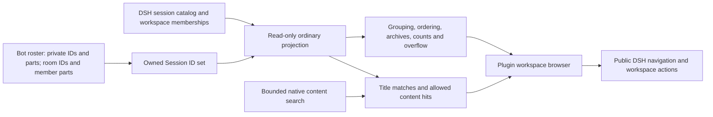

# Ordinary conversations in the workspace browser

The owner requested hiding Bot conversations from the ordinary workspace list. This supersedes the earlier decision to leave that browsing region native. Bot selection stays beside Manage team. Multiple independent private conversations per Bot are out of scope.

## Public boundary

DSH 0.2.1-rc.2 exposes `sidebar.workspaces` but no public row-visibility predicate. The plugin registers its own component in that single slot, retaining the original entry's public viewing store and injected navigation callbacks through `slots.entries`. No DSH files, global hooks or Session catalog snapshots are patched. It does not read or render private host components, or claim the original browser's child slots. Unloading the plugin releases the registration and restores the native browser with its existing data.

The native sidebar's branding, New chat, companion entry, Plugins, schedules, account and settings remain in place. Ordinary conversations still render through the native conversation components.

## Visibility

- Exclude each Bot's identity, current Session and historical parts; each group's relay Session and all current/historical member Sessions in `room.parts`.
- Do not infer ownership from names, path, workspace ID or parent ID. Ordinary DS Agent sessions and ordinary forks remain visible. A normal conversation named Chief in the DS Bot workspace remains normal.
- Preserve DSH's subagent-origin filtering and selected-blank presentation. Filtering happens before grouping, archive filtering, counting, overflow and search limiting. No transient startup rows render before the roster baseline.
- Keep actual workspace registrations. As of .4, hide an assistant-related folder header when its filtered ordinary rows are empty. Recognize these folders using the team's workspace ID, Bot/group work directories, owned Session cwd and owned membership, never a display name. Unrelated empty folders remain visible. A selected blank ordinary chat, ordinary messages, or ordinary archives shown by the current filter restore their folder header. Hidden empty parents do not hide ordinary descendant workspaces in tree view.
- Never write filtered memberships, pin sets or archive sets back. Reordering a visible subset preserves hidden members in saved positions. All history remains reachable through the companion.
- This is a browsing change, not a backend authorization or memory isolation boundary. It does not alter upstream tools, context compression, delegation or memory.

## Controls and limits

The replacement supports grouped/tree/flat views, persisted expansion and view preferences, recency/manual order, within-group drag ordering, workspace ordering, counts/overflow, title/content search, archive filters, selection/status, pin/unpin, rename, fork, copy ID and archive/unarchive. It uses `uiWorkspace` methods for ordinary session mutations; running work requires explicit Stop and archive confirmation. The native rename dialog and keyboard commands remain available. Workspace add/rename/remove use public callbacks; the folder flow supports a typed path, public directory listing and the native chooser when available. Removing a workspace preserves files and conversations.

The native browser's child-slot declarations are inactive while replaced. Third-party row decorations/menu entries cannot be rendered here through a public API; this browser implements its own standard controls. Native row animations, every tooltip and directory-creation UI are not replicated. The folder registration flow accepts existing directories. No new slot or extension of DSH core is introduced.

Native content search returns at most 20 ranked hits and a `hasMore` flag, without a cursor or exclusion predicate. Filter those hits and merge with local ordinary title/path matches. Keep a refine-query hint when the host reports truncation; do not claim an exhaustive ordinary-content result or invent a visible count for unseen hits. New ownership changes arrive through the existing roster refresh.

## Verification

`test/workspace-list.test.js` covers private/group/history ownership, ungrouped and mixed workspaces, ordinary Agents/forks/same-name rows, blank and subagent filtering, archive modes, counts, content search before limiting, rollover updates, nesting, and preserving hidden IDs during reorder.

`dev/workspace-ui.mjs` runs only in the isolated `.dsh-test-*` mock-model bench. It verifies filtering after a real group creates a member work session; grouped/flat/archive/search views; a renamed ordinary conversation with the same name as a Bot; pin/rename/archive/restore; workspace browsing/add/rename/collapse/remove; theme and narrow layouts. `dev/companion-ui.mjs` retains the archive-recovery regression using DSH's native archive shortcut now that the Bot row is hidden.

Actual DSH Desktop remains a separate acceptance check after installing the local package. No user profile or real model credentials are used by these checks.

`dev/empty-workspace-ui.mjs` adds two registered synthetic assistant folders and an unrelated empty folder. It verifies that both assistant headers disappear while their registrations and the companion remain usable; a new ordinary conversation makes its header visible again, as do archive filters when applicable. The test restores its temporary team/Bot directory settings afterward.

### 0.2.0-myagent.3 result

- DSH 0.2.1-rc.2, Node 24.14.1, Windows and headless Edge in the isolated mock-model bench.
- Full unit suite: 850 passed, 0 failed, 1 skipped (the existing Windows trailing-space path case).
- Generated client check passed; lint passed with the same 11 upstream warnings.
- Companion flow passed, including native settings, ordinary replies and single-click recovery after native-keyboard archiving of the hidden Main Bot.
- Workspace flow passed, including a real group member work session, title/content search isolation, same-name ordinary chat, pin/rename/archive/restore, and folder add/rename/collapse/remove. Active-work archive confirmation and cancellation also passed.
- Inspected light/dark workspace screenshots and exercised the 1024px layout. Browser checks reported no unhandled errors. No DSH core or host implementation changed.

### 0.2.0-myagent.4 result

- Hide empty assistant folder headers, including a separately registered custom companion directory, without deleting registrations or filtering unrelated empty workspaces.
- Full suite: 854 passed, 0 failed, 1 skipped (the existing Windows case). Generated client check and lint passed; lint retained the same 11 warnings.
- Isolated Edge check passed: both empty assistant headers disappear; an unrelated empty folder and the Bot chat remain; a selected blank or ordinary conversation restores its folder; archive filters expose ordinary archives when requested. Inspected the resulting sidebar screenshot. No user DSH profile or host implementation changed.
